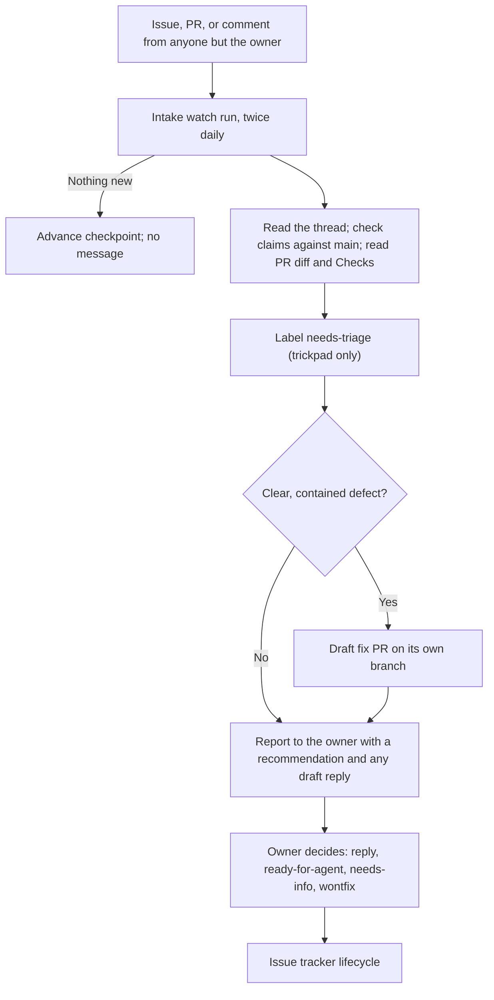

# Trickpad factory

This guide covers how outside issues and pull requests reach the maintainer. It spans this repository and `nweii/thirdwind-site`, the website that hosts the Trickpad guide. Implementation, review, and release follow the sources linked from `AGENTS.md`; this guide does not restate them.

## Intake from outside contributors

| Service | Product |
| --- | --- |
| Ticket tracker | GitHub Issues in both repositories ([issue tracker](issue-tracker.md), [triage labels](triage-labels.md)) |
| Ticket source | Outside users and contributors |
| Git host | GitHub |
| Orchestrator | A Claude scheduled task, "Trickpad intake watch", in the owner's Trickpad project; its prompt holds the run's instructions |
| Runner | A Claude Code cloud session with `gh` access scoped to the two repositories |
| Observability platform | None: the project thread shows each report, and the scheduled task records each run |

The intake watch task:

1. **Trigger.** The scheduled task's clock, at 8:38 AM and 4:38 PM Eastern.
2. **Action.** A script in the owner's project files lists issues, PRs, issue comments, and review comments created since a saved checkpoint, excluding the owner and bots. The run reads each item, checks an issue's claims against the default branch, reads a PR's diff and its `Checks` run, and subscribes to new outside PRs so their CI and review events reach the same thread.
3. **Next.** For an outside issue that is a clearly reproducible defect with a small, contained cause, the run drafts one fix: a new `fix/issue-<number>-<slug>` branch from `main`, opened as a draft PR that refers to the issue without closing it, built through pstack's bug-fix playbook. At most one draft per run, and none when a fix PR for that issue already exists. Feature requests, design questions, and defects whose cause needs hardware to confirm wait for the owner, who labels them `ready-for-agent` or asks for the work.
4. **Human re-entry.** The owner answers the run's report in the project thread and reviews any draft PR before marking it ready. Any reply on GitHub is drafted in that report and posted only with the owner's approval.
5. **Duplicates.** The checkpoint advances only after a report is posted, so a failed run lists the same items again; the run also skips items already reported in its thread.

## Boundaries

- The run may add `needs-triage` to an outside issue or PR in this repository and open one draft fix PR per run from its own branch. It does not comment, review, close, merge, push to anyone else's branch, approve workflow runs for forks, or apply any other label, because anything it posts appears as the owner's.
- A draft fix's evidence is its `Checks` run (build and `check.sh`). Gesture behavior on hardware stays the owner's check before the PR leaves draft.
- These limits are instructions to the run, not a platform control: the session acts through the owner's GitHub identity. Holding them by permission would need a separate GitHub App or token limited to issues, pull requests, and `fix/` branches.
- A `Checks` job on `macos-26` cancelled after about 15 minutes with no logs means GitHub assigned no runner. The report treats it as capacity and suggests a re-run, not a code fix.

## Operating evidence

- Shaped with `factory-guide` 0.3.2.
- Not yet exercised against a live outside item; the first such report is the pilot. Review the arrangement after five reported items, or sooner if the owner has to relay an item the watch missed.
- `thirdwind-site` has no `needs-triage` label, so the run reports its items without labelling them.
