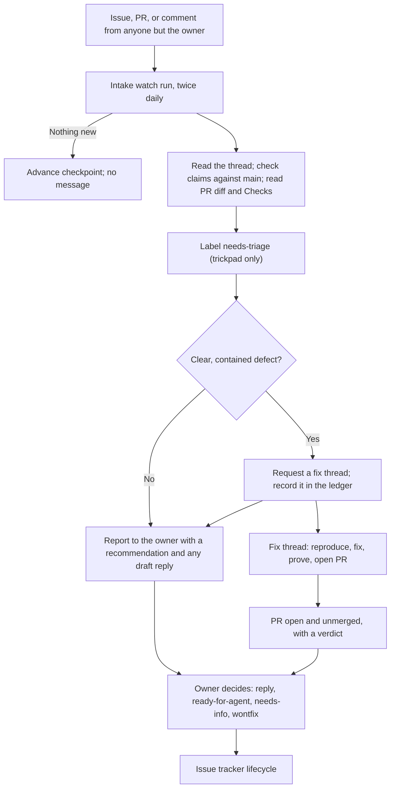

# Trickpad factory

This guide covers how outside issues and pull requests reach the maintainer. It spans this repository and `nweii/thirdwind-site`, the website that hosts the Trickpad guide. Implementation, review, and release follow the sources linked from `AGENTS.md`; this guide does not restate them.

## Intake from outside contributors

| Service | Product |
| --- | --- |
| Ticket tracker | GitHub Issues in both repositories ([issue tracker](issue-tracker.md), [triage labels](triage-labels.md)) |
| Ticket source | Outside users and contributors |
| Git host | GitHub |
| Orchestrator | A Claude scheduled task, "Trickpad intake watch", in the owner's Trickpad project; its prompt holds the run's instructions |
| Runner | Claude Code cloud sessions with `gh` access scoped to the two repositories: the watch thread on Sonnet, and one thread per fix on Opus |
| Observability platform | None: the project thread shows each report, and the scheduled task records each run |

The intake watch task:

1. **Trigger.** The scheduled task's clock, at 8:38 AM and 4:38 PM Eastern.
2. **Action.** A script in the owner's project files lists issues, PRs, issue comments, and review comments created since a saved checkpoint, excluding the owner and bots, plus any requested fix that has gone quiet. The run reads each item, checks an issue's claims against the default branch, reads a PR's diff and its `Checks` run, and subscribes to new outside PRs so their CI and review events reach the same thread. It writes no fix itself.
3. **Next.** For an outside issue that is a clearly reproducible defect with a small, contained cause, the run requests one fix thread and records the request in a ledger beside the script. At most one request per run, and none when a fix thread or PR for that issue exists. Feature requests, design questions, and framing choices wait for the owner, who labels them `ready-for-agent` or asks for the work.
4. **Human re-entry.** The owner answers the run's report in the project thread. Any reply on GitHub is drafted in that report and posted only with the owner's approval.
5. **Duplicates.** The checkpoint advances only after a report is posted, so a failed run lists the same items again; the run also skips items already reported in its thread.

The fix task:

1. **Trigger.** A request from an intake watch run, carrying the issue, the observed failure, and the suspected cause.
2. **Action.** A separate project thread on its own branch works under the owner's `agent-runway` full stop: pstack's bug-fix playbook, then that skill's PR delivery steps. It reproduces the failure, fixes it, proves the fix, gets an independent review, and opens a pull request whose body says `Refs #N`.
3. **Next.** Nothing automatic. The thread stays with its PR through CI and review-bot findings, then stops.
4. **Human re-entry.** The PR, open and unmerged, with one verdict: ready to merge, waiting for approval, or blocked. It is marked ready only when proof covers every change in the diff. A fix whose behavior needs fingers on hardware stays a draft, blocked on the exact check the owner must do.
5. **Duplicates.** The ledger holds one entry per requested issue until its PR closes. The watch reports an entry with no PR after a day, or whose open PR has been quiet for three days.

## Boundaries

- The watch may add `needs-triage` to an outside issue or PR in this repository. It does not comment, review, close, merge, push, approve workflow runs for forks, or apply any other label, because anything it posts appears as the owner's.
- A fix thread may commit and push to its own branch and open one pull request. It never merges, enables auto-merge, comments on the issue, or pushes another branch.
- A fix's proof is a reproduction that fails before and passes after, a focused check in `scripts/check.sh` where the behavior has one, and the `Checks` run. The owner's Mac mini, reached through Remote Control with Trickpad Dev, serves proof that needs the running app. Gesture behavior on hardware stays the owner's check.
- These limits are instructions to the run, not a platform control: the session acts through the owner's GitHub identity. Holding them by permission would need a separate GitHub App or token limited to issues, pull requests, and its own branches.
- A `Checks` job on `macos-26` cancelled after about 15 minutes with no logs means GitHub assigned no runner. The report treats it as capacity and suggests a re-run, not a code fix.

## Operating evidence

- Shaped with `factory-guide` 0.3.2.
- The watch has run on an empty interval: no report, checkpoint advanced. It is not yet exercised against a live outside item, and no fix thread has run; the first of each is the pilot. Review the arrangement after five reported items, or sooner if the owner has to relay an item the watch missed.
- `thirdwind-site` has no `needs-triage` label, so the run reports its items without labelling them.
